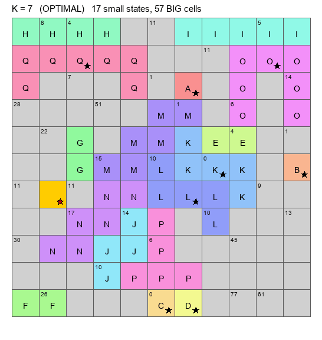

# Jane-Street-Puzzles
Detailed solution for Jane Street Puzzles

https://drive.google.com/drive/folders/1eS_19jZLyKXJExIX_RxgBQwePUq5wHhF?usp=drive_link

---

## October 2026 — 11×11 States & Capitols (CP-SAT, K = 14)

The `October_2026/` folder contains the CP-SAT model used to tackle the 11×11
puzzle.  It solves the small-clue part exactly for every clue `T ≤ 14` and
returns a **partial solution**: all clues are essentially solved except for
the biggest state, of size **37**, which the model leaves as an unresolved
BIG region.  That partial solution is good enough to be completed and
corrected by human eye.  See `October_2026/README.md` for the full write-up.

**Technique in short.**  Enumerate every placement of every symmetric
polyomino of size ≤ 14 (together with its real capitol, derived from the
capitol rule).  Every cell is either covered by one such placement or marked
`BIG`, meaning it belongs to a state of size > 14; BIG cells are priced at
`15`.  Because a BIG–BIG edge costs 15, which is more than any enforced clue
`T ≤ 14`, such edges are never used on a shortest path for an enforced clue,
so the small-clue distance equations are exact.  CP-SAT then chooses the
placements, the BIG components and the distances, subject to:

- every BIG connected component has at least 15 cells (rooted-flow encoding);
- at most one BIG capitol;
- Manhattan-ball necessary condition: a clue of value `T` needs a capitol
  within Manhattan distance `(T + 1) // 2`;
- weighted-distance equations with a tight predecessor for every non-capitol.

The K = 14 run returns the partial solution in ~335 s (235,050 placements):
16 small states, 34 BIG cells, 1 BIG capitol, with 0 enforced-clue failures.
The 37-cell state itself is left inside the BIG region and is not determined
by the model; that is the part completed by hand.  The same model at K = 15
is infeasible, so K = 14 is the largest K solved by this decomposition.
